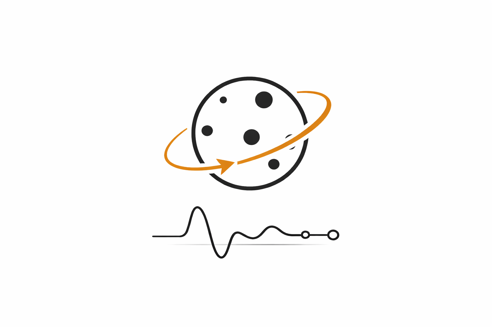
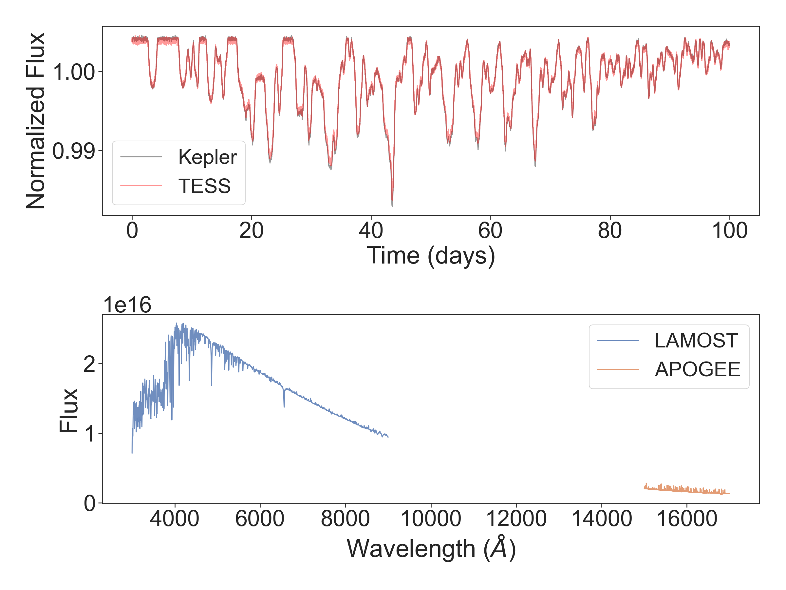

<div align="center">

  # Dynamo
  
  <br>
  
  **Towards realistic stellar observables**

  [](https://opensource.org/licenses/MIT)
  [](https://www.python.org/downloads/)
  []()
</div>

---
**Dynamo** is a Python package for simulating stellar light curves and spectra, combining detailed models of stellar evolution, surface activity, planetary transits, and noise. It is based on several existing open-source projects that were modified and combined to create a stronger link between stellar evolution and stellar observables.




## Features

- **Stellar Surface Simulation**: Models the emergence and evolution of star spots and active regions using configurable activity cycles, latitude distributions, and spot evolution laws. This part is based on the [Butterpy](https://github.com/zclaytor/butterpy) package.
- **Grid-based lightcurve and spectra**: Generates synthetic spectra and light curves, including the effects of limb darkening, rotational broadening and spot evolution. This is done in a grid approach and motivated by the [Starsim](https://github.com/dbarochlopez/starsim) package.
- **Multi-instrument Observations**: Simulates realistic observations for specific instruments (e.g., LAMOST, APOGEE, Kepler, TESS).
- **Stellar Evolution Parameters**: Interpolates stellar parameters (e.g., mass, radius, temperature, luminosity) from evolutionary models. To get stellar evolution parameters we use [kiauhoku](https://github.com/zclaytor/kiauhoku) package. 

Using **Dynamo** we can easily link between stellar evolution parameters (Temperature, mass, logg, etc.) and magnetic-driven spots. Such connection enable the creation of simulated light curve and spectra of the same star, which can serve as a simulated dataset for multi-modal machine learning models for example.

---

## Installation

1. Clone the repository:
   ```bash
   git clone https://github.com/IlayMalinyak/Dynamo.git
   cd Dynamo
   ```

2. Install dependencies:
   ```bash
   pip install -r requirements.txt
   ```

## Usage

### Simulating a Star

You can configure and run a stellar simulation by editing the `star.conf` file and using the main classes in the `Dynamo` package. Example:

```python
from Dynamo.star import Star

# Initialize a star from configuration
star = Star(conf_file_path='star.conf')

# Set up simulation times and wavelength grid
import numpy as np
times = np.linspace(0, 30, 1000)  # 30 days, 1000 points
wavelengths = np.linspace(4000, 9500, 1000)  # Angstroms

# generate spots map
sm.generate_spot_map(ndays=1000)
# Run the forward simulation
star.compute_forward(t=times, wv_array=wavelengths)

# Access results (e.g., light curve, spectra)
# star.results, star.spot_map, etc.
```

### Example: Generating a Dataset of Light Curves and Spectra

You can generate a full dataset of physically-consistent light curves and spectra using the script `dataset/create_data.py`. This script samples stellar parameters, simulates surface activity, and produces time series and spectra for each synthetic star.
**Note-in dataset/create_data.py we assume some priors that might be non-trivial (for example age-activity and spot-activity relationships). You might want to edit them for your use case**

### Command-Line Usage

```bash
python -m Dynamo.create_data \
    --models_root /path/to/stellar/models \
    --dataset_dir dataset \
    --plot_dir images \
    --plot_every 100 \
    --num_simulations 1000 \
    --ndays 1000 \
    --n_cpu 4
```
Add `--skip_download` to use only the PHOENIX models already on disk, `--base_seed` to
offset the per-star seeds, and `--q_activity_dep` to make the facular area ratio fall
with activity.
this would create 1000 simulations of 1000 days each. The arguments are:

- `--models_root`: Path to the directory containing stellar evolution models.
- `--dataset_dir`: Output directory for the generated dataset (default: `dataset`).
- `--plot_dir`: Directory to save diagnostic plots (default: `images`).
- `--plot_every`: Save a plot every N simulations (default: 100).
- `--num_simulations`: Number of stars (light curves/spectra) to generate (default: 1000).
- `--ndays`: Number of days to simulate for each light curve (default: 1000).
- `--n_cpu`: Number of CPU cores to use for parallel processing (default: 1).

## Configuration

Simulation parameters are controlled via the `star.conf` file, which includes sections for:

- Stellar properties (mass, radius, temperature, rotation, etc.)
- Spot and faculae properties (see *Faculae* below)
- Limb darkening
- Planetary parameters
- Noise characteristics

See the comments in `star.conf` for detailed descriptions of each parameter.

### Faculae

Each spot is surrounded by a facular annulus with outer radius `r_spot * sqrt(1 + Q)`,
where `Q` (`facular_area_ratio`, or the per-star `Facula Q` column) is the facular to
spot area ratio (solar value about 3). Facular brightness follows the solar
centre-to-limb law of Meunier et al. (2010),

    dT(mu) = scale * (250.9 - 407.7 mu + 190.9 mu^2)  K,

so faculae are nearly invisible at disk centre and bright near the limb. Their
intensity at each grid ring is a blend between the photosphere and a PHOENIX model
300 K hotter, weighted by `dT(mu) / 300`. `facula_contrast_scale` multiplies the law
(its Teff dependence is not well known). Faculae decay on their own time scale,
`facula_lifetime_ratio` times the spot decay time, so they outlive their spots. Spectra
include a separate facular velocity kernel. `Q = 0` reproduces the spot-only model.

Spot temperature contrast follows the Berdyugina (2005) Teff relation times a per-star
`Spot Contrast Scale`. Every simulated star has its own random `Seed`, so spot maps
are reproducible per star and independent across stars.

Known limitations: the facular law is solar; faculae exist only as annuli around
spots (no independent network); the facular intensity is a linear blend in temperature
between two PHOENIX models; spot lifetime does not depend on spot size.

**Bug fix (2026-10):** earlier versions paired each PHOENIX `mu` with the intensity
from the opposite side of the disk, which made the spot signal depend almost only on
the central grid element. Data generated before this fix should be regenerated.

## License

This project is licensed under the MIT License. See `LICENSE` for details.

## Acknowledgments

- PHOENIX stellar atmosphere models
- [Butterpy](https://github.com/zclaytor/butterpy)
- [Starsim](https://github.com/dbarochlopez/starsim)
- [kiauhoku](https://github.com/zclaytor/kiauhoku)

---

## Contact
ilay.kamai@campus.technion.ac.il