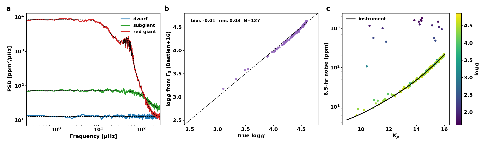

# Stellar + instrumental background

Every star varies even without spots. `Dynamo/background.py` adds granulation, p-mode
oscillations and photon/read noise to the clean Dynamo light curves as a
post-processing step (`scripts/add_background.py`). The clean curves are kept; one
simulation can receive many realisations or instruments.

| component | model |
|---|---|
| granulation | two Harvey profiles, Kallinger+2014: b1 = 0.317 νmax^0.970, b2 = 0.948 νmax^0.992, a = 3710 νmax^-0.613 M^-0.26 ppm |
| oscillations | l = 0,1,2 comb (Δν, ε from Mosser+2011), Gaussian envelope FWHM 0.66 νmax^0.88, A_max = 2.5 L^0.838 M^-1.32 (Teff/Tsun)^-1 ppm (Huber+2011), linewidth 0.95 (Teff/Tsun)^10 μHz |
| white noise | photon + read/background + floor; Kepler: 4.5e9 e⁻ in 6.5 h at Kp 12 (Jenkins+2010); TESS: 1.5e4 e⁻/s at T 10 |
| sampling | sinc² integration over the cadence and aliasing of power above Nyquist |
| magnitude | survey-like, p(m) ∝ 10^(0.3m) on Kp 9–16 / T 7–13 (default), or from L, Teff and the table distance |

Convective background is tapered to zero above ~7000 K.

## Validation (`docs/background_validation.png`)

* **a** synthesized PSDs (1000 d, Kepler 30-min) match the input model, including the
  aliased dwarf granulation and the red-giant oscillation hump at νmax.
* **b** the 8-hr flicker of the synthetic background reproduces the observed Kepler
  F8–logg relation of Bastien+2016: bias −0.01 dex, rms 0.03 dex (N = 127 stars of the
  smoke table in the relation's range). The real relation has 0.1–0.2 dex scatter;
  ours is tighter because every star sits exactly on the scaling relations
  (no star-to-star scatter in amplitudes yet).
* **c** 6.5-hr noise: dwarfs follow the instrument curve (16 ppm at Kp 12, ~210 ppm at
  Kp 16); giants are dominated by their own granulation (0.5–2 ppt).

## Not modelled

δ Sct / γ Dor pulsations of hot stars, mixed l = 1 modes of red giants, Kepler
systematics (quarters, safe modes; `Dynamo/noise.py` has an unused version), spot
activity of giants (a change to the simulation itself, not a background), and
intrinsic scatter around the scaling relations.

    python scripts/add_background.py DATASET --instrument Kepler [--realizations N]
    python scripts/background_validation.py DATASET/simulation_properties.csv
