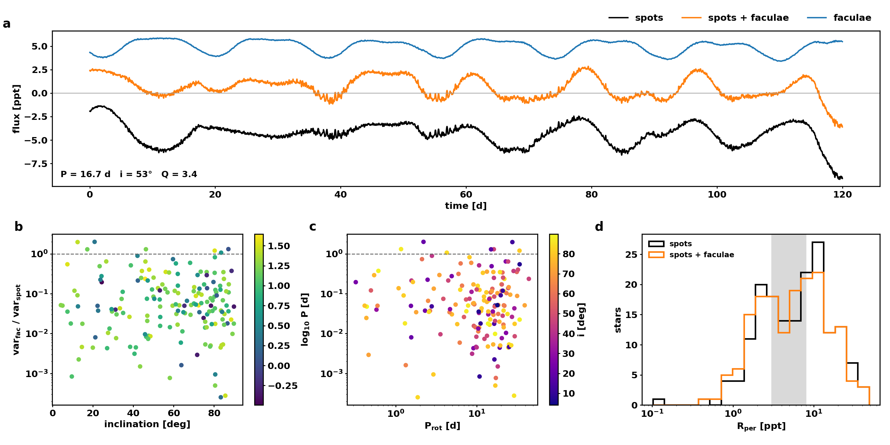

# Faculae smoke dataset

Stars with a spot dynamo: 171 (of 200 simulated). Kepler band, 1000 days, noise-free.

## Amplitude [ppt]

Full: q95 - q05 over the whole light curve (includes cycle-scale trends). R_per: median over one-period windows of the q95 - q05 range (McQuillan et al. 2014 definition, comparable to Kepler).

| percentile | full, faculae | full, spots only | R_per, faculae | R_per, spots only |
|---|---|---|---|---|
| 5 | 2.46 | 2.87 | 1.12 | 1.29 |
| 25 | 5.15 | 5.44 | 2.42 | 2.74 |
| 50 | 11.65 | 13.58 | 5.8 | 6.69 |
| 75 | 22.14 | 24.01 | 11.59 | 12.18 |
| 95 | 39.85 | 47.95 | 22.8 | 25.71 |

Target (docs/FACULAE_PLAN.md A5): median 3-8 ppt, 5th percentile below 1 ppt. Kepler reference: R_per median about 5 ppt with a long tail below 1 ppt (McQuillan et al. 2014).

## Faculae-dominated fraction (var(facular signal) > var(spot signal))

`rot` columns use the rotational-timescale component only (running mean over 3 rotations removed).

### By rotation period

| P_bin | n | fac_dominated | fac_dominated_rot | median_var_ratio | median_rot_var_ratio | median_amp_ppt |
|---|---|---|---|---|---|---|
| P < 15 d | 99 | 0.111 | 0.03 | 0.122 | 0.05 | 13.116 |
| 15-25 d | 53 | 0.151 | 0.038 | 0.197 | 0.051 | 9.309 |
| P > 25 d | 19 | 0.211 | 0.105 | 0.132 | 0.051 | 6.284 |

### By inclination

| i_bin | n | fac_dominated | fac_dominated_rot | median_var_ratio | median_rot_var_ratio | median_amp_ppt |
|---|---|---|---|---|---|---|
| i < 30 | 29 | 0.276 | 0.103 | 0.213 | 0.048 | 9.201 |
| 30-60 | 49 | 0.102 | 0.02 | 0.189 | 0.074 | 9.956 |
| 60-90 | 93 | 0.108 | 0.032 | 0.123 | 0.051 | 12.945 |

Overall faculae-dominated: 0.135 (total), 0.041 (rotational).

## Verdict (2026-10-12)

Runs: 200 stars (171 with a spot dynamo), 1000 d, Kepler 30-min, noise-free, identical
spot maps in both arms (`scripts/make_paired_tables.py`), Athena jobs 177415/177416.
Generated with the approximate grid coverage and the old evolved-star rule (giants
spotless); both arms share these, so the facular difference is unaffected.

| criterion (docs/FACULAE_PLAN.md) | target | result | |
|---|---|---|---|
| amplitude median (R_per) | 3-8 ppt | 5.8 ppt | pass |
| amplitude 5th percentile (R_per) | < 1 ppt | 1.1 ppt | marginal |
| faculae-dominated fraction rises with P (Montet+2017) | qualitative | 11% / 15% / 21% (P < 15 / 15-25 / > 25 d); rotational 3% / 4% / 10% | pass (n = 19 slow) |
| faculae relatively stronger at low inclination | qualitative | 28% (i < 30°) vs 10-11% | pass |
| runtime increase with faculae | < 30% | +20% (158 vs 132 s/star, shared node) | pass |

Notes
* Faculae brighten (net offset tracking activity) and partly cancel the spot
  modulation: R_per median drops from 6.7 to 5.8 ppt. On the rotational timescale the
  facular variance is ~5% of the spot variance (median), i.e. rotation remains
  spot-dominated, as for the Sun.
* The R_per distribution is bimodal (peaks near 2 and 10 ppt; Kepler is unimodal).
  Amplitude is set mainly by `Spot Max Area` (Spearman 0.76 vs 0.28 for activity), and
  the spot count `0.1 sqrt(ar) ndays` is clipped to [20, 500]: every star with
  ar > ~25 (about 40%, incl. all saturated young stars) sits at 500 spots and forms the
  high mode. Calibration item, not a faculae issue.
* The full-light-curve amplitude (q95 - q05 over 1000 d) is ~2x R_per because of
  cycle-scale trends; Kepler PDC removes those, so R_per is the comparable number.
