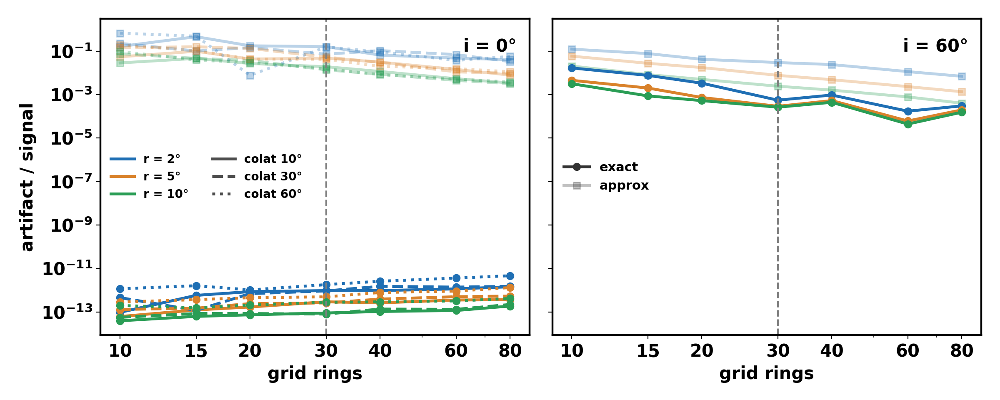
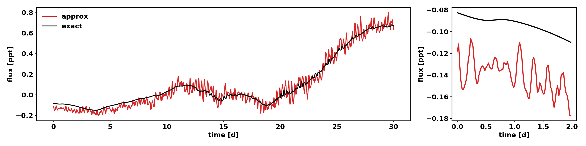

# Spot-on-grid discretisation artifact

Script: `scripts/grid_artifact.py` (single constant spot, 5800 K, Kepler band,
one rotation, no noise). Data: `docs/grid_artifact.csv`, figure `docs/grid_artifact.png`
(solid = exact coverage, faded = original approximation).

## Fix: exact coverage (default)

`nbspectra.exact_spot_coverage` computes the exact area of each spot cap (and
facular annulus) inside every grid cell. At each colatitude the cap covers a
longitude interval of known half-width; its overlap with every cell of the ring is
exact, and the colatitude integral uses 8-point Gauss-Legendre after a cosine
substitution, split where the cap starts to cover whole circles. Cells of a ring
tile the circle, so a spot moving in longitude conserves its area exactly
(rel. spread ~1e-15); moving in colatitude the area error is < 2e-5.

The original approximation (`nbspectra.calculate_*_coverage`, linear in the
spot-cell distance) is kept behind `exact_coverage : false` in `star.conf` /
`star.exact_coverage = False`. Planet transits still use the approximate
disk-cell overlap.

## Results

**Pole-on (i = 0).** The true light curve is flat. Artifact = peak-to-peak / spot
depth, worst of three spot colatitudes (10, 30, 60 deg):

| rings | r = 2° approx | r = 2° exact | r = 5° approx | r = 5° exact | r = 10° approx | r = 10° exact |
|---|---|---|---|---|---|---|
| 20 | 0.18 | 1e-12 | 0.13 | 5e-13 | 0.037 | 2e-13 |
| 30 (current max) | 0.16 | 2e-12 | 0.053 | 5e-13 | 0.019 | 3e-13 |
| 60 | 0.069 | 4e-12 | 0.016 | 9e-13 | 0.0054 | 3e-13 |

**i = 60°.** rms(f_N − f_ref) / ptp(f_ref), reference = 120 rings, exact:

| rings | r = 2° approx | r = 2° exact | r = 5° approx | r = 5° exact | r = 10° approx | r = 10° exact |
|---|---|---|---|---|---|---|
| 20 | 4.2% | 0.34% | 1.8% | 0.07% | 0.50% | 0.05% |
| 30 | 3.0% | 0.06% | 0.77% | 0.03% | 0.24% | 0.03% |
| 60 | 1.1% | 0.02% | 0.23% | 0.006% | 0.08% | 0.004% |

The residual exact-coverage error at i = 60° comes from the ring-wise mu
discretisation (one intensity per ring); it is smooth in time, not a ripple.
Exact coverage at 30 rings beats the approximation at 80 rings. Wall time per
light curve is unchanged within noise (~14 s here, dominated by setup).

The old approximation also under-counted spot area: the depth of a 5° spot rises by
1.5% with exact coverage. Data generated before this change carries the ripple at
P_rot / (cells per ring), ~40 ppm rms for a typical spotted dwarf.

## On a generated star (`docs/exact_coverage_lc.png`)

Weakly spotted K dwarf (Teff 4155 K, P_rot 27.7 d) from the 30-d trial table, clean
Kepler light curve. Sub-day rms 40 ppm -> 7 ppm; the 0.255-d (P_rot / 108) peak is
gone.
